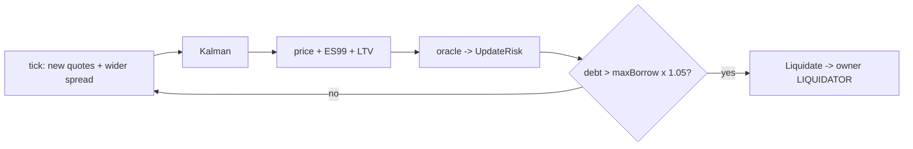

# `examples/oracle_liquidation_demo.py` – pricing engine ↔ chain, live
Shows the answer to "how does the pricing engine drive the chain": yields and spreads widen over four ticks; each tick the oracle re-prices and writes `UpdateRisk`; the on-chain `maxBorrow` falls below the 80,000 debt and `Liquidate` finally succeeds.

Observation worth saying in the video: the filter lags the raw quotes (8.7% vs 10.5% at t3) – safer against noise, slower in a crash; the main protective effect here comes from the *price* falling, with LTV tightening only modestly.
