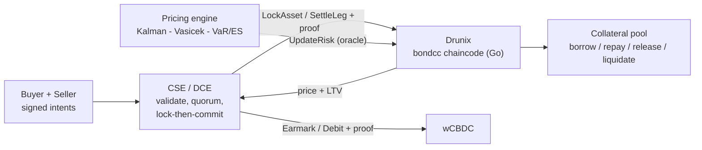

# Drunix-hackathon

Repo for tokenised asset coordination engine and marketplace connector.

The Drunix Hackathon proposal in detail document can be made available on request. Email to [fastrpayments@gmail.com](mailto:fastrpayments@gmail.com)

> **Confidentiality notice:** Please do not circulate or use the flows without prior information. Submission is made to reveal the internal work of FastrPay (a stealth startup) as a programmable payment platform. It should be treated confidentially or with relevant permissions.

Thanks
Amit
FastrPay Team

---

# FastrPay Coordination State Engine (CSE) – Tokenised Corporate Bonds on Drunix

**NPCI Drunix Hackathon - Fintech Infrastructure Innovation : A verifiable Coordination State Platform & Problem statement 2:** *Real-asset tokenisation – digital tokens with smart contracts that atomically manage ownership, collateralisation, transfer and release.*

## The problem and how Drunix is used for tokenised Bond platform
A tokenised bond trade spans two independent systems: the bond ledger (**Drunix**) and the cash platform (**wCBDC**). Each finalises its own leg, and nothing makes the two conditional on each other without a custodian or escrow. Whoever moves first is exposed, and a failure on one side leaves a half-done trade.

## The solution
**Separate coordination from execution.** The **Coordination State Engine (CSE)**, run as a network of institution-operated **Distributed Coordination Engine (DCE)** nodes, decides when both legs are cleared. It never holds funds or assets. Each system locks or earmarks its own leg in place, the DCE nodes agree the batch by quorum and issue a cryptographic proof, and each system verifies that proof before settling. If anything fails or the timer expires, everything is released. A stochastic pricing engine prices the bond, sets collateral LTV and gates trade prices. The CSE is comprised of governed/permissioned Distributed Coordination nodes for resilience, censorship and no concentration of authority. This Architecture can easily be extended to other forms of DLT, Oracles and protocols when required. 



## Quick start
```bash
pip install -r requirements.txt
python3 examples/basic_example.py            # one bond through every block (start here)
python3 examples/oracle_liquidation_demo.py  # pricing engine drives the chain: stress -> liquidation
python3 demo.py                              # happy path + 5 failure paths + reconciliation
python3 tests/test_parity.py                 # mock and real chain adapter share one interface
```
Running against a real Drunix network: [docs/RUNBOOK.md](docs/RUNBOOK.md)

## Repository map
Every script has its own `<script>.README.md` next to it, with a function table and a workflow diagram.

| Script | Documentation | Role |
|---|---|---|
| `chaincode/bondcc/contract.go` | [contract.README.md](chaincode/bondcc/contract.README.md) | Go chaincode: tokens, KYC, proof verifier, DvP legs, collateral pool |
| `chaincode/bondcc/main.go` | [main.README.md](chaincode/bondcc/main.README.md) | Chaincode entry point |
| `cse/engine.py` | [engine.README.md](cse/engine.README.md) | CSE state machine, quorum, abort/retry, audit chain |
| `cse/crypto.py` | [crypto.README.md](cse/crypto.README.md) | ed25519 signatures shared with the chaincode |
| `cse/ledgers.py` | [ledgers.README.md](cse/ledgers.README.md) | Python twin of the chaincode + wCBDC mock |
| `cse/drunix_adapter.py` | [drunix_adapter.README.md](cse/drunix_adapter.README.md) | Python to chaincode bridge |
| `cse/reconcile.py` | [reconcile.README.md](cse/reconcile.README.md) | Three-records-to-one reconciliation, model-value hook |
| `pricing/models.py` | [models.README.md](pricing/models.README.md) | Kalman, Vasicek, bond pricing, VaR/ES, LTV, order router |
| `pricing/oracle.py` | [oracle.README.md](pricing/oracle.README.md) | Pricing engine to `UpdateRisk` on-chain |
| `demo.py` | [demo.README.md](demo.README.md) | Success and failure scenarios |
| `examples/basic_example.py` | [basic_example.README.md](examples/basic_example.README.md) | Narrated single-bond walkthrough |
| `examples/oracle_liquidation_demo.py` | [oracle_liquidation_demo.README.md](examples/oracle_liquidation_demo.README.md) | Pricing to chain to liquidation, live |
| `tests/test_parity.py` | [test_parity.README.md](tests/test_parity.README.md) | Interface guard |
| `push.sh` | [push.README.md](push.README.md) | Publish helper |

Further docs: [Architecture](docs/ARCHITECTURE.md) · [Gap analysis vs proposal](docs/GAP_ANALYSIS.md) · [Runbook](docs/RUNBOOK.md) · [Video script](docs/VIDEO_SCRIPT.md)

## Status
| Working and tested | Written, not yet run | Not built (roadmap) |
|---|---|---|
| CSE state machine, abort and retry, ed25519 proofs verified by chain logic, hash-chained audit log, reconciliation, pricing engine, oracle-driven price band and liquidation (all on mock ledgers) | Go chaincode `bondcc` (needs `go build` and a Drunix network), `PeerCLITransport` | ZK proof, private data collections, hashlock, Trade and PaymentReservation contracts, full BFT protocol, marketplace, UPI and foreign-RTGS adapters, real wCBDC |


## Team
FastrPay – Amit (founder) and team.

Please do not circulate or use the flows without prior information.
Submission is made to reveal the internal work of FastrPay(a stealth startup) as a programmable payment platform. And it should be treated confidentially or with relevant permissions.

Thanks

Amit

FastrPay Team
