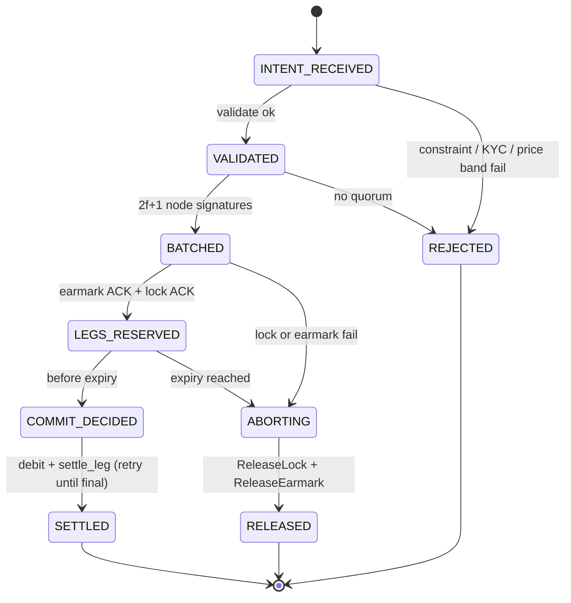
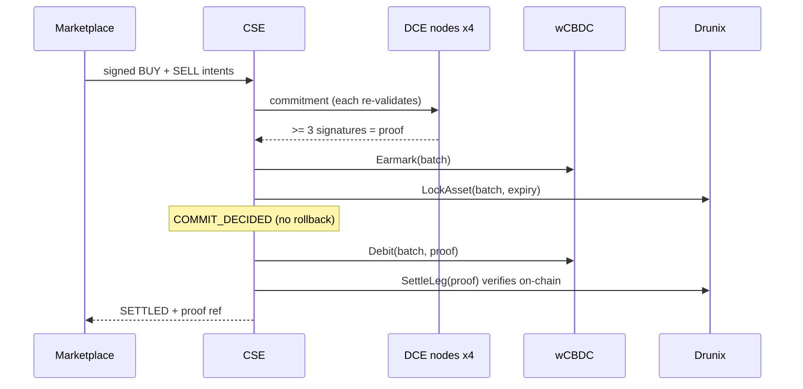

# `cse/engine.py` – Coordination State Engine
**Purpose.** Coordinates both legs of a trade without ever holding value. Implements Amit's state machine.

| Item | Role |
|---|---|
| `S`, `LEGAL` | States and the only legal transitions (illegal move → assertion) |
| `sign(priv, intent)` | Wallet signature over canonical intent |
| `merkle_root(hashes)` | Batch commitment over sorted intent hashes |
| `DCENode.vote(commitment, valid)` | Node signs only if **its own** call to `valid()` is true; `byzantine=True` withholds |
| `CSE._validate(intents)` | Signature, KYC, intent expiry, atomicity rule, token/price match, ownership, funds, **price band vs model value** |
| `CSE.execute_dvp(buy, sell)` | The whole flow (below) |
| `CSE._abort(b, token, reason)` | ABORTING → release lock + earmark → RELEASED |
| `CSE._go` / `verify_audit` | Transition + hash-chained audit entry; recompute chain to detect tampering |

**Limits.** Quorum signing is not a full BFT protocol; one pair per batch; `_validate` is shared code so a bug there is shared by all nodes (real nodes run their own implementation).
