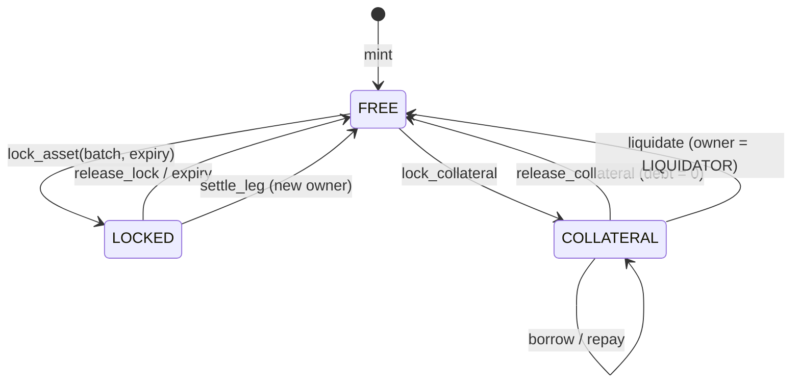
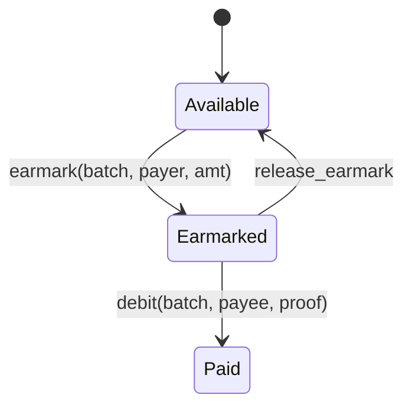

# `cse/ledgers.py` – settlement domains (mocks)
**Purpose.** `MockDrunix` is a line-by-line Python twin of the Go chaincode (same function names, same integer maths). `MockWCBDC` is the cash leg. Lets everything run with no network; swap `MockDrunix` for `DrunixClient` to use the real chain.

**MockDrunix** – `set_kyc, list_asset, update_risk, mint, get_token, get_asset` (registry) · `lock_asset, release_lock, settle_leg` (DvP) · `max_borrow, lock_collateral, borrow, repay, release_collateral, liquidate, get_position` (pool). Internal `_verify` = CSEVerifier. Fault flag `fail_lock` is for demos only.
**MockWCBDC** – `fund, transfer, earmark, release_earmark, debit` (+ `fail_earmark` flag). `debit` and `settle_leg` are idempotent so the CSE can retry after commit.

**Rules enforced.** `settle_leg` needs: locked for *this* batch · not expired · receiver KYC'd · ≥ threshold valid node signatures. `borrow` needs fresh price (<24 h) and `debt + amount ≤ units×price×LTV`. `liquidate` only if `debt > maxBorrow × 1.05`.
