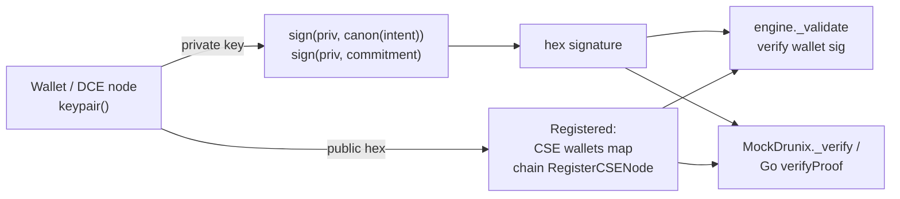

# `cse/crypto.py` – signatures
**Purpose.** One signature scheme (ed25519) shared by wallets, DCE nodes and the Go chaincode (`crypto/ed25519`), so a proof signed in Python verifies on-chain.

| Function | What it does |
|---|---|
| `keypair()` | New ed25519 key; returns `(private_key_object, public_key_hex)` |
| `sign(priv, msg: bytes)` | Returns hex signature |
| `verify(pub_hex, msg, sig_hex)` | `True/False`, never raises |
| `canon(intent)` | Canonical JSON bytes of an intent **excluding** its `sig` field (sorted keys, no spaces) so signer and verifier hash identical bytes |

**Limits.** Keys live in memory; production needs HSM/KMS (the deployment diagram shows Fabric CA + HSM). Replay protection relies on `nonce` + batch IDs.
