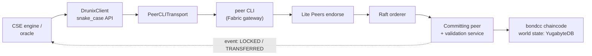

# `cse/drunix_adapter.py` – Python → chaincode bridge
**Purpose.** Same interface as `MockDrunix`, but each call becomes a transaction on the `bondcc` chaincode of a Drunix (HLF 2.5-compatible) network.

| Class / method | Chaincode function |
|---|---|
| `PeerCLITransport.invoke/query` | wraps `peer chaincode invoke/query` (params: channel, chaincode name, orderer, `peer_flags` for TLS/endorsers, env for the CSE org identity) |
| `set_kyc` `list_asset` `update_risk` `mint` | `SetKYC` `ListAsset` `UpdateRisk` `MintToken` |
| `lock_asset` `release_lock` `settle_leg` | `LockAsset` `ReleaseLock` `SettleLeg` (proof sent as JSON) |
| `lock_collateral` `borrow` `repay` `release_collateral` `liquidate` | `LockCollateral` `Borrow` `Repay` `ReleaseCollateral` `Liquidate` |
| `get_token` `get_position` `get_asset` | `GetToken` `GetPosition` `GetAsset` (queries → JSON) |

Errors from the peer become `LedgerError`, so the CSE abort path is identical for mock and real chain. **Not yet tested against a live network.** Production: replace the CLI with the Fabric Gateway gRPC client and add an event listener for acknowledgements.
