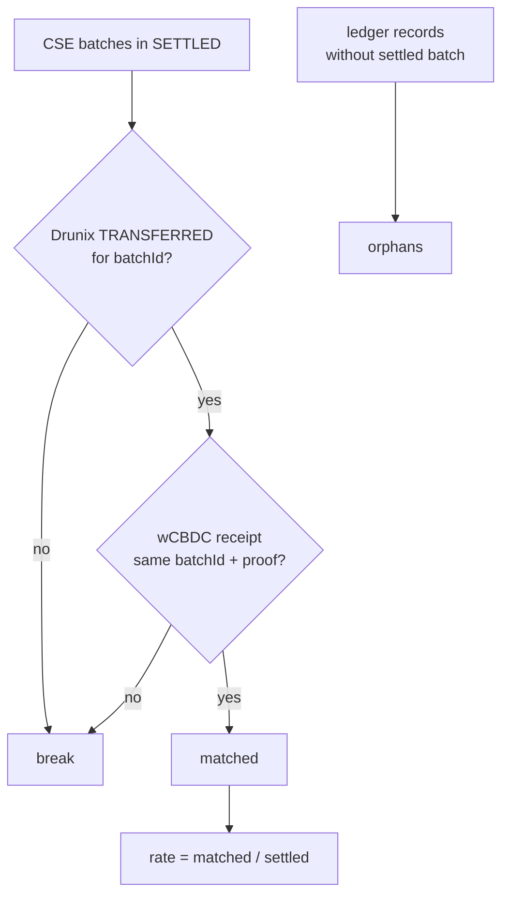

# `cse/reconcile.py` – reconciliation & pricing hook
| Function | What it does |
|---|---|
| `reconcile(cse, dx, cb)` | For every SETTLED batch checks that a Drunix `TRANSFERRED` event **and** a wCBDC receipt exist for the same `batchId` with the same proof reference. Returns `settled, matched, rate, orphans` (orphans = ledger records with no settled batch = reconciliation breaks) |
| `fair_value_from_chain(dx)` | Returns `fair_value(token_id)` = `units × priceE6/1e6` using the oracle price on-chain. Passed to `CSE(fair_value=…, band=0.05)` so mispriced trades are rejected |

Works on `MockDrunix` (reads `events`); with the real chain, build the same view from chaincode events.
