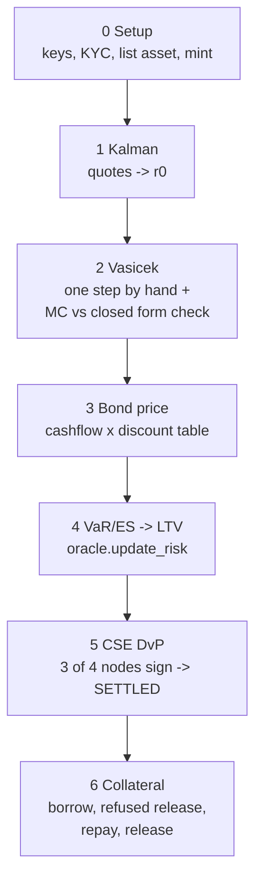

# `examples/basic_example.py` – one bond through every block
`python3 examples/basic_example.py` (`--backend peer` to use a real Drunix network). Every chain call is traced as `[chain] function(args)`.

Story: IssuerB sells 1000 units of a 2-year 8% bond (face 100) to BankA for ≈ INR 98,316; BankA pledges it, borrows half the limit, repays and gets it back. Numbers shown: r0 7.12%, price 98.316, LTV 85%.
